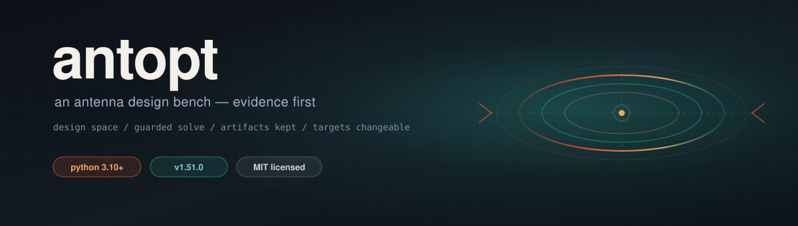
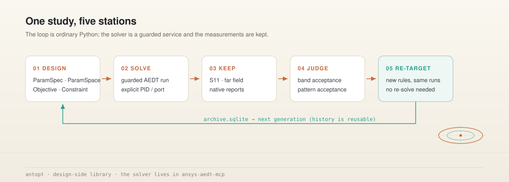

<p align="center">
  
</p>

<p align="center">
  <a href="https://github.com/Hawse1337/antopt/actions/workflows/ci.yml"></a>
  <a href="https://github.com/Hawse1337/antopt/releases/latest"></a>
  <a href="LICENSE"></a>
  
</p>

# Keep the measurement. Change the target.

`antopt` is a design bench for antenna studies. You describe a parameter space and what "good"
means, the library drives candidates through a guarded AEDT session, and every solve leaves its raw
artifacts behind. When the requirement changes — a different band, a tighter ripple, a flatter
elevation cut — you re-judge the history instead of burning another night of solver time.

> **中文简介**：[README.zh-CN.md](README.zh-CN.md)  
> The web GUI / desktop application is under validation and is **not** part of this repository.
> This release is the design-side library plus its agent skill.



## The bench

Four verbs, one loop:

- **Design** — `ParamSpec` / `ParamSpace` describe the knobs, `Objective` / `Constraint` describe the
  target. Nothing here knows about AEDT.
- **Solve** — a candidate becomes a real run through the companion guard
  ([ansys-aedt-mcp](https://github.com/Hawse1337/ansys-aedt-mcp)). Sessions are addressed explicitly;
  budgets are spent, not assumed.
- **Keep** — S11 Touchstone, far-field grids and native report images stay with the run record. A
  number without its artifact is a rumour.
- **Judge** — acceptance rules are code (`band_acceptance`, `pattern_acceptance`, `acceptance`), so a
  verdict can be recomputed, compared and challenged.

The archive is the point. A *campaign* is just a Python recipe over that loop; swap the evaluator
(dry model or real solve) and the same recipe still runs.

## What it refuses to hide

| risk | how antopt handles it |
|---|---|
| "the result looks great" | every measured run keeps `result.s1p`, `farfield_views.json` and the native report PNGs |
| "we changed the target, re-run everything" | records are re-scored; the solver is not called again unless you ask |
| "the surrogate says it is good" | dry/surrogate results are labelled `PREDICTED`; validation state is explicit |
| "the solve died, we lost the point" | failed runs are recorded as failed, with the reason, not dropped |
| "which AEDT session was that?" | the guard requires one explicit PID or gRPC port per call |

## Try it in one minute

```powershell
py -3.10 -m venv .venv
.\.venv\Scripts\python.exe -m pip install -U pip
.\.venv\Scripts\python.exe -m pip install -e ".[optimizer,surrogate,plot]"

python -m antopt version
python -m antopt dry-demo --samples 64
```

`dry-demo` is a complete study on an analytic objective — Latin-hypercube design, Pareto archive,
no AEDT required. The same shape in code:

```python
from antopt.core import Objective, ParamSpace, ParamSpec, latin_hypercube
from antopt.optimize import Evaluation, pareto_archive

space = ParamSpace([
    ParamSpec("ring_radius", "mm", 20.0, 60.0, 40.0),
    ParamSpec("ring_height", "mm",  1.0, 10.0,  4.0),
])
objectives = [Objective("gain", "peak_gain", "maximize"),
              Objective("bw", "s11_bandwidth", "maximize")]

runs = [Evaluation("c%02d" % i, "ring", p,
                   metrics={"peak_gain": predict_gain(p),
                            "s11_bandwidth": predict_bw(p)}, feasible=True)
        for i, p in enumerate(latin_hypercube(space, 32, seed=1))]
front = pareto_archive(runs, objectives)
```

## Real studies

1. Install the guard system and its virtual environment (PyAEDT 1.10.0, AEDT 2026 R1).
2. Point `ANTOPT_AEDT_EXE`, `ANTOPT_GUARD_REPO`, `ANTOPT_VENV_PYTHON`,
   `ANTOPT_REFERENCE_PROJECT`, `ANTOPT_CAMPAIGN_ROOT` at your machine.
3. Run the worker against a campaign directory; each candidate gets its own run folder and archive
   row.

The contract, the run lifecycle and the artifact layout are in
[user_doc/aedt_integration.md](user_doc/aedt_integration.md), with a walkthrough in
[examples/aedt_campaign.md](examples/aedt_campaign.md).

## Drop it into an agent

The repository ships an agent skill at [`SKILL.md`](SKILL.md). To use it in a skill-based agent
(for example DeepSeek Harness), copy the file into the agent's skill directory:

```powershell
New-Item -ItemType Directory -Force "$env:USERPROFILE\.dsh\skills\antopt" | Out-Null
Copy-Item SKILL.md "$env:USERPROFILE\.dsh\skills\antopt\SKILL.md"
```

The skill teaches the agent when to use the bench, where the core APIs live, and which evidence rules
to follow. It deliberately does **not** cover the GUI, which is not published.

## Repository map

```text
assets/        banner + loop illustrations
antopt/        the library
  core.py        parameter spaces, objectives, constraints
  optimize.py    evaluations, dominance, Pareto archive
  campaign.py    campaign recipes
  runtime/       measured-run manager + job store (no web server)
  worker.py      command-line measured campaign worker
  aedt_host.py   AEDT process helpers
  cases/         reference design cases (project paths left empty)
  benchmark/  interop/  optimizer/  parametric/  physics/  surrogate/  topology/
user_doc/      installation, architecture, workflow, AEDT integration, validation
examples/      dry study + measured-campaign walkthrough
tests/         offline suite (no AEDT needed)
SKILL.md       agent skill
```

## Status

- Offline suite: **778 passed, 80 subtests**; CI runs it on Windows / CPython 3.12.
- Measured runs are exercised on AEDT 2026 R1 through the guard; any solver number quoted from a
  study must be accompanied by its run artifacts.
- Wheel and sdist: [v1.51.0 release](https://github.com/Hawse1337/antopt/releases/tag/v1.51.0).

## License

MIT — see [LICENSE](LICENSE). If you build a study on top of this bench, keep the artifacts; a bench
without evidence is just furniture.
