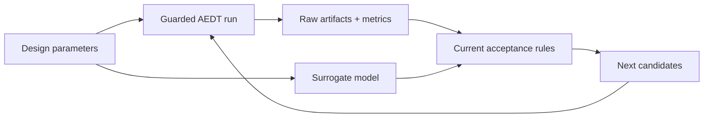

# antopt

**Physics-guided antenna design and optimisation, with measured runs as first-class evidence.**

`antopt` is a Python library for simulation-driven antenna studies: it defines a design space,
evaluates candidates (dry models or real AEDT solves through a guarded runner), keeps the raw
measurements, and lets the objective function change later without re-solving.

This repository is the **design-side library**. The web GUI / desktop packaging is still under
validation and is intentionally **not** part of this release. Real AEDT execution is delegated to
the companion guard system, [ansys-aedt-mcp](https://github.com/Hawse1337/ansys-aedt-mcp).

**Version 1.51.0** · Python **3.10+** · [User guide](user_doc/README.md) · [Examples](examples/) ·
[Changelog](CHANGELOG.md)

## Why antopt?

A real antenna solve can take tens of minutes and produces much more than one number: an S11 curve,
far-field cuts, native reports. `antopt` separates *what was measured* from *how it is scored*:



- **Keep the measurements.** Runs are archived with their parameters, artifacts and status, so a
  revised target can be re-evaluated from history instead of re-solved.
- **Compose the loop in Python.** Parameter spaces, constraints, objectives, surrogates, acquisition
  and acceptance checks are ordinary classes you wire together in a campaign recipe.
- **Acceptance is explicit.** Bandwidth, ripple, axial leakage and other acceptance rules live in
  code (`band_acceptance`, `pattern_acceptance`, `acceptance`) and produce readable verdicts.

## Install

```powershell
py -3.10 -m venv .venv
.\.venv\Scripts\python.exe -m pip install -U pip
.\.venv\Scripts\python.exe -m pip install -e ".[optimizer,surrogate,plot]"
```

Optional extras:

| extra | supplies |
|---|---|
| `optimizer` | `pymoo`, `scipy` (NSGA-II and numeric utilities) |
| `surrogate` | `scikit-learn` (Gaussian-process surrogates) |
| `acquisition` | `torch`, `botorch`, `gpytorch` (BoTorch acquisition) |
| `plot` | `matplotlib` (result plots) |
| `dev` | `pytest` |

## Try it without AEDT

```powershell
python -m antopt version
python -m antopt cases
python -m antopt dry-demo --samples 64
```

`dry-demo` runs a Latin-hypercube study on an analytic objective and prints the Pareto archive, so
the loop can be exercised on a machine without a solver. The same flow is in
[`examples/dry_run_demo.py`](examples/dry_run_demo.py).

```python
from antopt.core import ParamSpec, ParamSpace, latin_hypercube
from antopt.optimize import Evaluation, pareto_archive

space = ParamSpace([
    ParamSpec("radius", "mm", 30.0, 70.0, 50.0),
    ParamSpec("height", "mm", 1.0, 12.0, 6.0),
])
candidates = latin_hypercube(space, 32, seed=7)
evaluations = [Evaluation("c%02d" % i, "demo", params,
                          metrics={"peak_gain": f(params)}, feasible=True)
               for i, params in enumerate(candidates)]
```

## Real AEDT runs

The measured path talks to an AEDT session through the guard system:

1. Install [ansys-aedt-mcp](https://github.com/Hawse1337/ansys-aedt-mcp) and its `.venv`
   (PyAEDT 1.10.0, AEDT 2026 R1).
2. Start or attach to an AEDT gRPC session (explicit PID or port — the guard refuses implicit
   sessions).
3. Configure `reference_project`, `campaign_root`, `guard_repo` and `venv_python` through the
   `ANTOPT_*` environment variables or a config file.
4. Run a campaign: each candidate is copied, parameters applied, solved, exported and scored by the
   current acceptance rules; artifacts stay under the campaign directory.

See [user_doc/aedt_integration.md](user_doc/aedt_integration.md) and
[user_doc/workflow.md](user_doc/workflow.md) for the contract and a walkthrough.

## Package layout

```text
antopt/
├── core.py            parameter spaces, objectives, constraints
├── optimize.py        evaluations, dominance, Pareto archive
├── campaign.py        campaign recipes and scheduling
├── worker.py          measured-run worker (calls the guarded runner)
├── runtime/runner.py   real-run manager (formerly the GUI runner backend)
├── runtime/store.py   run archive / SQLite job store
├── farfield.py        far-field export, pattern views
├── band_acceptance.py S11 band checks from Touchstone
├── pattern_acceptance.py  ring/directivity acceptance rules
├── benchmark, cases, parametric, interop, optimizer, physics, surrogate, topology
└── tests/             offline test suite
```

## Status and claims

- Offline suite in this checkout: **778 passed, 80 subtests** (no AEDT required).
- The measured path is exercised against AEDT 2026 R1 via the guard; solver results depend on the
  project, mesh and machine, and are recorded per run as evidence rather than claimed globally.
- The web GUI/desktop app, its HTTP API and packaging are **not** included; they remain under
  validation.

## License

MIT — see [LICENSE](LICENSE).
