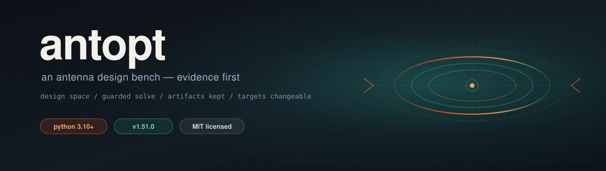

# antopt · 天线设计工作台

> **保留每一次测量，随时更换目标。**

`antopt` 是一个面向天线研究的“设计工作台”：你描述参数空间和“好”的定义，库把候选方案送进受控的
AEDT 求解会话，并且让每次求解的原始产物留在记录里。需求变化时（换频段、收紧纹波、压扁俯仰面），
你重新判定历史测量，而不是再烧一夜求解时间。

<p align="center">
  
</p>

- **设计**：`ParamSpec` / `ParamSpace` 描述变量，`Objective` / `Constraint` 描述目标；这一层不依赖 AEDT。
- **求解**：候选方案经由配套的守卫系统
  [ansys-aedt-mcp](https://github.com/Hawse1337/ansys-aedt-mcp) 提交真实 AEDT 运行；会话必须显式指定
  PID 或 gRPC 端口，预算被记录而不是假设。
- **保留**：S11 Touchstone、远场网格、原生报告图片与运行记录放在一起；没有产物的数字不算证据。
- **判定**：验收规则写在代码里（`band_acceptance`、`pattern_acceptance`、`acceptance`），可以重算、
  对比、被质疑。

## 一分钟试用（不需要 AEDT）

```powershell
py -3.10 -m venv .venv
.\.venv\Scripts\python.exe -m pip install -U pip
.\.venv\Scripts\python.exe -m pip install -e ".[optimizer,surrogate,plot]"

python -m antopt version
python -m antopt dry-demo --samples 64
```

`dry-demo` 在解析目标函数上跑完整研究：拉丁超立方采样 + Pareto 存档。

## 真实 AEDT 研究

安装守卫系统（PyAEDT 1.10.0 / AEDT 2026 R1），配置 `ANTOPT_AEDT_EXE`、`ANTOPT_GUARD_REPO`、
`ANTOPT_VENV_PYTHON`、`ANTOPT_REFERENCE_PROJECT`、`ANTOPT_CAMPAIGN_ROOT`，然后用 worker 跑 campaign。
每个候选方案都有独立 run 目录与存档记录。

详见 [user_doc/aedt_integration.md](user_doc/aedt_integration.md) 与
[examples/aedt_campaign.md](examples/aedt_campaign.md)。

## 作为 Agent Skill 使用

仓库自带 [`SKILL.md`](SKILL.md)。把它复制进 agent 的 skill 目录即可：

```powershell
New-Item -ItemType Directory -Force "$env:USERPROFILE\.dsh\skills\antopt" | Out-Null
Copy-Item SKILL.md "$env:USERPROFILE\.dsh\skills\antopt\SKILL.md"
```

## 不发布的部分

Web GUI / 桌面版的 HTTP 服务、静态页面、启动器与安装包仍在验证阶段，**不在本仓库中**。本仓库是
设计侧库 + 其 agent skill。

## 许可

MIT。基于这个工作台做研究时，请把产物与结论一起保留。
