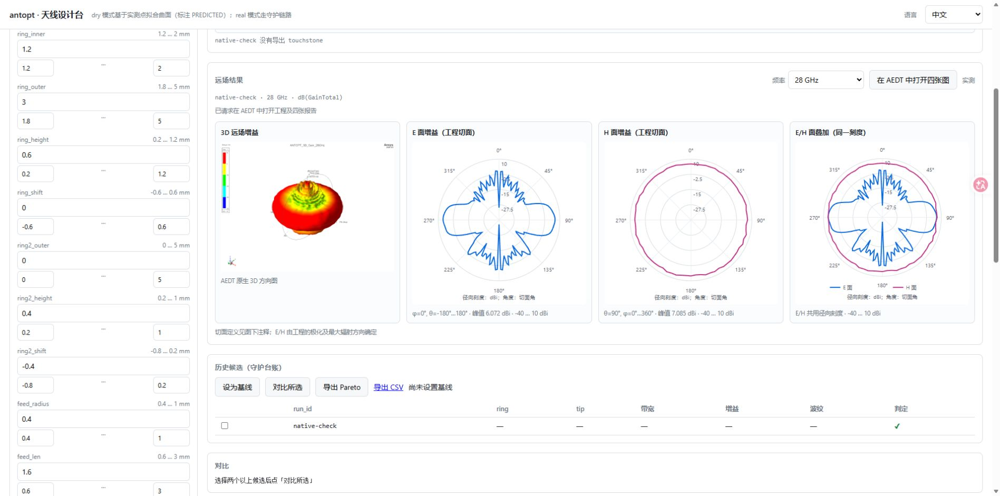

# 远场报告自动生成与打开

改动已集成到 `<repo>` 的源码版设计台。重启源码版后，真实运行完成时会创建、保存并打开四张 AEDT 原生 Report，软件结果页也同时显示四张图。

| 结果 | 当前工程的扫描设置 |
|---|---|
| 3D 总增益 | 原工程 Infinite Sphere 的三维 `dB(GainTotal)` |
| E 面 | φ=0°，θ 从 −180° 到 180° |
| H 面 | θ=90°，φ 从 0° 到 360° |
| E/H 叠加 | 上述两个切面，共用 dBi 径向刻度 |

这次已修正此前把 φ=90°纵向切面固定叫作 H 面的错误。E/H 本质上由电场、磁场及最大辐射方向决定，不能只由“天线沿 Z 轴放置”推广到任意模型。本实现采用用户最终指定的上述工程切面；改变极化、主波束或坐标系时需要重新确认切面。

频率读取本工程已有远场解的实际频点，不固定为 28 GHz。多个频点可用时，页面四图同步切换；“在 AEDT 中打开四张图”也打开当前选中频率的四张报告。目前读取指定远场 setup 的 `LastAdaptive` 解，没有保存远场的扫频点不会出现在频率列表中。

## 在 AEDT 中再次打开

每个工程旁会生成 `<工程名>_查看方向图.cmd` 和 `.aster-reports.json`。以后双击该 CMD，或点击软件结果页的“在 AEDT 中打开四张图”，即可打开工程及四张报告，不需要逐个勾选。

本机 AEDT 2026 R1 实测：Report 定义能随 `.aedt` 保存，但普通关闭、再打开 `.aedt` 不会恢复这些报告窗口。因此，没有更改 `.aedt` 的系统文件关联；自动恢复窗口由上述入口完成。快捷入口打开的是该工程当前保存的报告。历史运行的图片与曲线另有独立快照，不会通过这个入口恢复历史几何模型。

入口使用明确的 AEDT PID，避免连接到另一个同名工程。原会话为无界面时，会先检查是否正在求解，仅在空闲时保存并关闭路径完全匹配的工程，再启动 GUI。后续打开复用已记录的 GUI。正在求解时提示等待；打开报告不会启动新求解。新的结果生成后，旧运行不能覆盖当前工程的启动文件。

## 3D 图的修正

软件优先显示 AEDT 原生 `3D Polar Plot` 导出的 PNG，保留 AEDT 的三维形状与颜色标尺。该图片是静态图；需要旋转查看时在 AEDT 中操作原生报告。原生图片缺失时，才显示带有 dB 径向刻度说明的交互预览。此前 Canvas 将 dB 转为线性功率半径，压缩了低增益方向，容易看起来很扁，不能据此判断物理方向图是平面。

E、H、叠加图使用一致的增益范围。E 面负 θ 使用实测对侧 φ=180°的数据组成，不作对称复制；H 面直接读取 θ=90°的 φ 扫描。仅更新 `ASTER_` 管理的四类报告，保留用户已有报告。

## 使用与验证

重启源码版设计台：

```powershell
cd <repo>
& '<guard-repo>\.venv\Scripts\python.exe' -m aster.app --real
```

旧安装包尚未重新构建，本次修改在源码版中生效。

- 完整 Python 回归 765 项通过；Node 远场页面行为测试通过。
- 在已有结果的独立工程副本上，最终部署的 `capture()` 成功读取 6,643 个方向点，生成并保存四张原生报告、导出四张 PNG。
- 当前真机验证频率是 28 GHz；多频选择另有 2.45/5.8 GHz 后端及 12 GHz 页面回归覆盖。
- 已实际保存、关闭工程，再通过最终入口连续打开两次，四张报告均自动打开，复用同一个 GUI。
- 已在 Edge 检查四图可见、H 面定义、共用刻度及打开按钮。未新增电磁求解，不能把本次后处理验证称为新一轮求解验收。



验证证据：`docs/evidence/farfield_views.json`。每次运行的快照位于 `runs/<guard_run_id>/artifacts/farfield_views.json`，原生图片位于同目录的 `native_reports/`。

参考：用户提供的[HFSS 方向图叠加教程](https://www.cnblogs.com/harper-blogs/p/18028416)；[ST 天线应用笔记中的 E/H 定义](https://www.st.com/resource/en/application_note/dm00068254.pdf)；[PyAEDT 原生报告图片导出](https://aedt.docs.pyansys.com/version/stable/API/visualization/_autosummary/ansys.aedt.core.visualization.post.post_common_3d.PostProcessor3D.export_report_to_jpg.html)；[PyAEDT 三维远场工具](https://aedt.docs.pyansys.com/version/stable/API/visualization/_autosummary/ansys.aedt.core.visualization.advanced.farfield_visualization.FfdSolutionData.plot_3d.html)。
