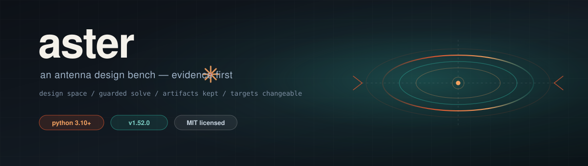
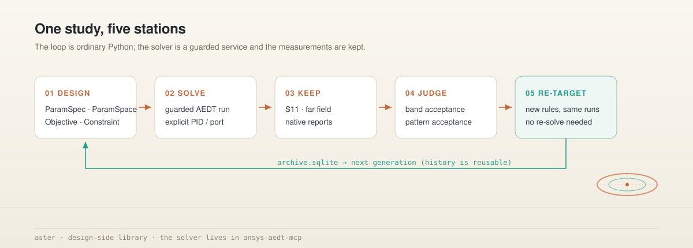

# aster

**An antenna design bench — evidence first.**

`aster` is a Python library, a command-line tool and an agent skill for simulation-driven antenna
studies. You describe a parameter space and what "good" means, the library drives candidates through
a guarded AEDT session, and every solve leaves its artifacts behind. When the requirement changes,
you re-judge the history instead of re-solving it.

<p align="center">
  
</p>

## Three ways to use it

| form | entry point | best for |
|---|---|---|
| **Library / CLI** | `pip install aster-<version>-py3-none-any.whl[optimizer,surrogate]`, then `aster doctor` | scripting your own loop, CI, notebooks |
| **Agent skill** | `aster skill install` or copy `skills/aster/` | an AI agent running design studies |
| **Docs + releases** | this site + [GitHub Releases](https://github.com/Hawse1337/aster/releases) | learning the contract, pinned wheels |

## Start in one minute

```powershell
python -m venv .venv
.\.venv\Scripts\python.exe -m pip install -U pip
.\.venv\Scripts\python.exe -m pip install "aster[optimizer,surrogate]"   # from a wheel
aster version
aster dry-demo --samples 64
```

`dry-demo` runs a complete study on an analytic objective — no AEDT required.

## The loop

<p align="center">
  
</p>

- **Design** — `ParamSpec` / `ParamSpace` for the knobs; `Objective` / `Constraint` for the target.
- **Solve** — real AEDT runs through the [ansys-aedt-mcp](https://github.com/Hawse1337/ansys-aedt-mcp)
  guard; explicit PID/port, budgeted, auditable.
- **Keep** — S11 Touchstone, far-field grids and native report images stay with the run.
- **Judge** — acceptance rules are code, so verdicts can be recomputed and compared.
- **Re-target** — changed rules re-score the archive; the solver is not called again.

## Next

- [Install](installation.md) · [Architecture](architecture.md) · [Workflow](workflow.md)
- [AEDT integration](aedt_integration.md) · [Agent skill](skill.md) · [Validation](validation.md)
- Repository: [github.com/Hawse1337/aster](https://github.com/Hawse1337/aster)

MIT licensed. If you build a study on this bench, keep the artifacts — a bench without evidence is
just furniture.
